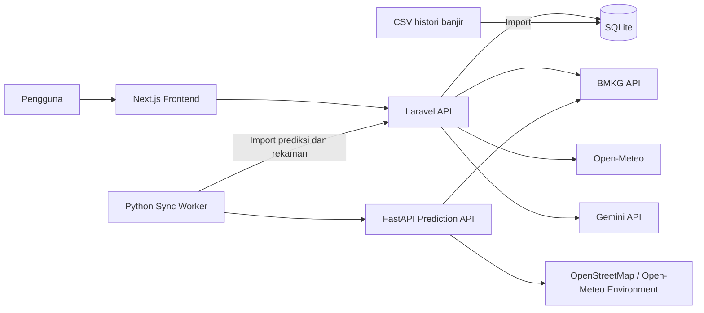

# SIGAB

## Identitas Tim

**Nama tim:**
Awikwok
**Daftar anggota:**

1. Aryanto Tri Nashrullah
2. Zelina Irene Chrisani
3. Alodia Kinnard Putri Kurnianto
4. Darma Sugiansyah Mustofa

## Informasi Aplikasi

- **Kategori:** Web
- **Nama aplikasi:** SIGAB (Sistem Informasi Geografis Antisipasi Banjir)
- **Deskripsi solusi:** Aplikasi untuk memantau kondisi cuaca, histori banjir, faktor lingkungan, dan estimasi risiko banjir hingga tingkat kelurahan/desa.
- **Masalah yang diangkat:** Informasi risiko banjir tersebar dan belum tersedia dalam satu tampilan yang mudah dipahami pada tingkat wilayah detail.
- **Target pengguna:** Masyarakat, pengelola data, relawan, dan instansi yang membutuhkan informasi pendukung kesiapsiagaan banjir.

## Fitur Utama

- Peta risiko banjir interaktif per wilayah.
- Estimasi skor dan kategori risiko banjir.
- Prakiraan cuaca dan curah hujan BMKG.
- Cuaca terkini dari Open-Meteo.
- Histori banjir dari dataset CSV dengan pilihan tahun.
- Grafik curah hujan harian dan pola hujan per jam.
- Ringkasan risiko berdasarkan kabupaten/kota dan kecamatan.
- Informasi sumber data dan ketersediaan komponen risiko.
- Pencarian kandidat sumber data lingkungan melalui Gemini.
- Sinkronisasi data melalui worker Python.

## Teknologi yang Digunakan

### Frontend

- Next.js 16, React 19, TypeScript
- Tailwind CSS dan Framer Motion
- Leaflet dan OpenStreetMap

### Backend

- PHP 8.3+
- Laravel 13
- SQLite
- Laravel API, Queue, dan Cache

### Layanan dan sumber data pihak ketiga

- BMKG untuk prakiraan cuaca.
- Open-Meteo untuk cuaca terkini dan data lingkungan tertentu.
- OpenStreetMap/Overpass untuk data geospasial pendukung.
- wilayah.id untuk katalog kode wilayah.
- DIBI BNPB sebagai referensi data kebencanaan.
- `partadox/history_flood_sby` untuk histori banjir terperinci.
- Gemini API untuk pencarian kandidat sumber data lingkungan.

## Arsitektur Sistem dan Alur Data



### Alur utama

1. Worker Python mengambil data wilayah dan prakiraan BMKG.
2. FastAPI menghitung prediksi berdasarkan komponen data yang tersedia.
3. Worker mengirim prediksi dan rekaman curah hujan ke Laravel.
4. Laravel menyimpan data ke SQLite dan menyediakan endpoint API.
5. Next.js mengambil data API dan menampilkan peta, grafik, histori, serta peringatan.
6. Gemini hanya membantu menemukan kandidat sumber data; hasilnya tidak langsung menjadi angka prediksi tanpa validasi.

## Struktur Direktori

```text
.
├── backend/
│   ├── app/                  # Controller, service, dan command Laravel
│   ├── database/             # Migration dan database SQLite
│   ├── python/               # FastAPI dan worker sinkronisasi
│   ├── routes/               # Route API Laravel
│   └── storage/app/private/  # Dataset privat
├── frontend/
│   ├── app/                  # Halaman dan komponen Next.js
│   ├── lib/                  # Client API dan tipe data
│   └── public/               # Asset frontend
└── README.md
```

## Instalasi dan Konfigurasi

### Prasyarat

- Node.js dan npm
- PHP 8.3 atau lebih baru
- Composer
- Python 3.11 atau lebih baru
- `uvicorn`
- Akses internet untuk mengambil data API

### Backend Laravel

```powershell
cd "D:\LombaUnesa2\SIGAB\backend"
composer install
Copy-Item .env.example .env
php artisan key:generate
php artisan migrate --force
```

Atur variabel penting pada `backend/.env`:

```dotenv
DB_CONNECTION=sqlite
GEMINI_API_KEY=
GEMINI_MODEL=gemini-3.1-flash-lite
GEMINI_GOOGLE_SEARCH=false
```

Jangan menyimpan API key di frontend atau meng-commit file `.env`.

### Frontend

```powershell
cd "D:\LombaUnesa2\SIGAB\frontend"
npm install
```

## Cara Menjalankan Aplikasi

Jalankan menggunakan empat terminal.

### Terminal 1 — Frontend

```powershell
cd "D:\LombaUnesa2\SIGAB\frontend"
npm run dev
```

Frontend tersedia di `http://localhost:3000`.

### Terminal 2 — Laravel API

```powershell
cd "D:\LombaUnesa2\SIGAB\backend"
php artisan serve
```

Laravel API tersedia di `http://127.0.0.1:8000`.

### Terminal 3 — FastAPI

```powershell
cd "D:\LombaUnesa2\SIGAB\backend"
uvicorn --app-dir python sigab_data.api:app --reload --port 8001
```

FastAPI tersedia di `http://127.0.0.1:8001`.

### Terminal 4 — Worker Sinkronisasi Python

```powershell
cd "D:\LombaUnesa2\SIGAB\backend\python"

$env:SIGAB_AREA_SCOPE="sidoarjo-surabaya"
$env:SIGAB_AREA_SAMPLE_PER_DISTRICT="0"
$env:SIGAB_SYNC_BATCH_SIZE="5"
$env:SIGAB_SYNC_INTERVAL_SECONDS="300"
$env:SIGAB_BMKG_REQUEST_DELAY_SECONDS="3"
$env:SIGAB_BMKG_MAX_RETRIES="4"
$env:SIGAB_ENVIRONMENT_RIVER_ENABLED="1"

python -m sigab_data.sync
```

## Import Histori Banjir

Dataset histori banjir berada di:

```text
backend/storage/app/private/bpbd-banjir-2020-2025.csv
```

Untuk mengimpor data:

```powershell
cd "D:\LombaUnesa2\SIGAB\backend"
php artisan history:import-detailed "D:\LombaUnesa2\SIGAB\backend\storage\app\private\bpbd-banjir-2020-2025.csv"
```

Hanya baris yang dapat dipetakan secara aman ke wilayah kelurahan/desa yang dimasukkan ke area detail.

## Endpoint Utama

- `GET /api/v1/areas`
- `GET /api/v1/areas/{slug}/risk`
- `GET /api/v1/areas/{slug}/rainfall`
- `GET /api/v1/areas/{slug}/current-weather`
- `GET /api/v1/predictions/latest`
- `GET /api/v1/flood-events`
- `GET /api/v1/flood-events/years`
- `GET /api/v1/history/summary`
- `GET /health` pada FastAPI

## Akun Demonstrasi

Tidak ada autentikasi pengguna pada versi ini.

**Username:**

**Password:**

## Dokumentasi Penggunaan AI


## Atribusi

- Framework dan library mengikuti lisensi masing-masing: Next.js, React, TypeScript, Laravel, FastAPI, Pydantic, Framer Motion, Leaflet, dan Tailwind CSS.
- Peta menggunakan Leaflet dan tile OpenStreetMap sesuai kebijakan OpenStreetMap.
- Data prakiraan cuaca bersumber dari BMKG.
- Data cuaca terkini dan sebagian data lingkungan menggunakan Open-Meteo.
- Data histori banjir terperinci menggunakan dataset `partadox/history_flood_sby`.
- Dataset dan kode pihak ketiga mengikuti lisensi serta ketentuan penggunaan sumber aslinya.

## Catatan

Informasi SIGAB bersifat pendukung dan bukan pengganti arahan resmi BPBD, BMKG, atau instansi berwenang.